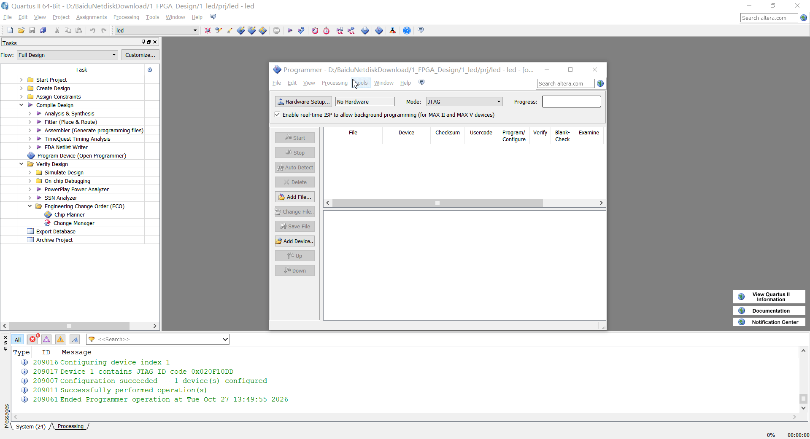
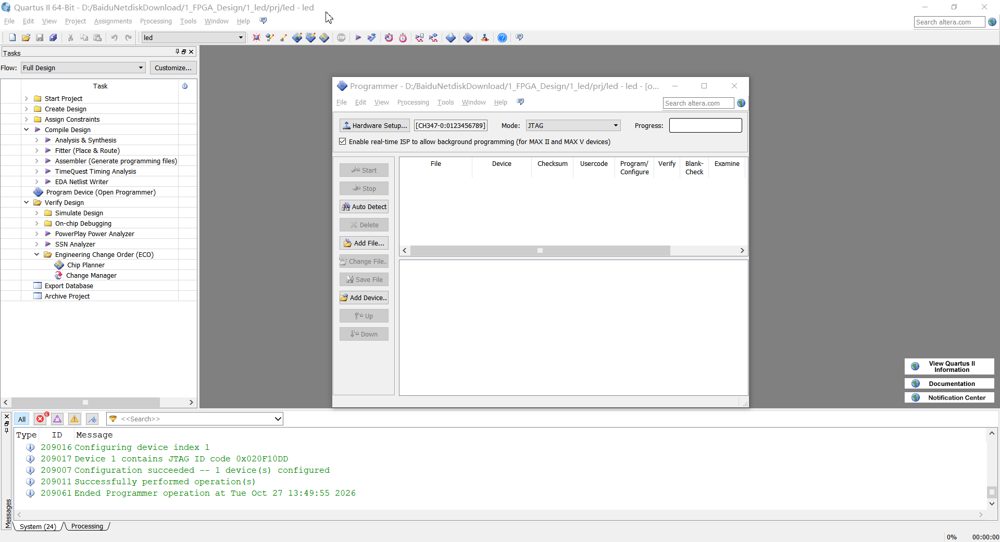
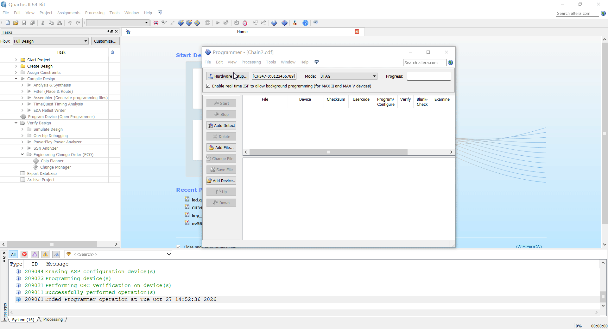

# CH347 在 Quartus 中的使用：器件识别、程序下载与 Flash 固化

用 EP4CE6、EP4CE10 这类 Cyclone IV FPGA 做开发，程序编译好后，下一步就是接上下载器，在 Quartus 里烧进去、跑起来。后面反复改逻辑、用 SignalTap 看内部信号，也都要用到 JTAG。

手头已有 CH347 调试板，就可以通过 `Quartus_IDE_CH347` 插件，把它接入 Quartus 的下载与调试流程。在硬件列表中选中 CH347 后，器件识别、`.sof` 下载、`.jic` 固化以及 SignalTap 在线调试，都可以继续使用 Quartus 自带的工具完成。下面按接线、安装、配置和实际操作的顺序说明。

## 一、插件把 CH347 接到哪里

CH347 是沁恒的高速 USB 转接芯片，提供 UART、I2C、SPI 和 JTAG 等接口。本文使用其中的 JTAG 接口，连接 FPGA 的 TCK、TMS、TDI、TDO 信号。芯片及接口能力可参考 [CH347 官方产品资料](https://www.wch.cn/products/CH347.html)。

插件采用 Quartus 的 `jtag_hw_*.dll` 硬件插件形式，由 JTAG 服务加载，再通过沁恒接口库访问 CH347。调用关系可以简化为：

```text
Quartus Programmer / SignalTap
              │
     jtag_hw_ch347.dll       Quartus 硬件插件
              │
     CH347DLLA64.DLL         沁恒 CH347 接口库
              │ USB
            CH347
              │ JTAG
             FPGA
              └─ 经 FPGA 间接访问配置 Flash
```

接入后，各项操作的用途如下：

| 操作 | 用来做什么 | 需要准备什么 |
| --- | --- | --- |
| 器件识别 | 扫描 JTAG 链，识别 FPGA | 已供电且接线正确的目标板 |
| `.sof` 下载 | 把配置写入 FPGA 的 SRAM，供当前上电期间运行 | 与目标 FPGA 匹配的 `.sof` 文件 |
| `.jic` 固化 | 经 FPGA 把配置写入板载 Flash，供后续上电加载 | 匹配 FPGA 和配置 Flash 的 `.jic` 文件 |
| SignalTap 在线调试 | 通过 JTAG 采集 FPGA 内部信号 | 包含 SignalTap 逻辑的设计及匹配的 `.stp` 文件 |

项目地址：[Quartus_IDE_CH347](https://gitcode.com/leozy/Quartus_IDE_CH347)。插件的发布文件、更新说明以该仓库为准。

## 二、先确认环境和接线

本文按项目的 Windows x64 插件说明部署：

| 项目 | 要求 |
| --- | --- |
| 操作系统 | Windows x64 |
| Quartus | 64 位版本，安装所需的 Programmer、SignalTap 组件 |
| 桥接芯片 | 项目列出的 CH347T、CH347F、CH339W，工作在 JTAG 模式 |
| USB 驱动 | 与设备匹配的沁恒 CH347 接口驱动 |
| 软件依赖 | `jtag_hw_ch347.dll`、`CH347DLLA64.DLL` |
| 配置文件 | `ch347.cfg`，用于设置 JTAG 时钟及日志 |

CH347T 需要切换到 Mode3，也就是 UART + JTAG 模式。CH347F 可同时提供多个接口，使用时确认引出的确实是 JTAG 信号。CH347T 的模式配置与接口驱动安装可参考 [官方评估板说明](https://www.wch.cn/special/ch347evt/)。

目标板按信号名称连接，不要仅凭排针位置判断：

| CH347 侧 | FPGA 目标板侧 |
| --- | --- |
| TCK | TCK |
| TMS | TMS |
| TDI | TDI |
| TDO | TDO |
| GND | GND |

目标板需要正常供电，两侧 JTAG 电平也要匹配。若使用带电平转换或独立 I/O 供电的调试板，按该板说明配置电压；不能只看 USB 已连接，就认为目标侧条件已经满足。

这份插件面向本地 JTAG 操作，不支持 32 位 Quartus、网络 JTAG，以及通过 Active Serial（AS）引脚直连配置 Flash 的烧写。后文的 `.jic` 固化走 JTAG 间接烧写，Programmer 中仍选择 JTAG 模式。

## 三、安装插件：文件要放到实际使用的版本里

先看清三个文件各自的用途：

| 文件 | 作用 | 部署要求 |
| --- | --- | --- |
| `jtag_hw_ch347.dll` | 向 Quartus 提供 CH347 硬件接口 | 保留原文件名，放入对应的 `bin64` 目录 |
| `CH347DLLA64.DLL` | 提供访问 CH347 的厂商接口 | 保留原文件名，建议与插件放在同一目录 |
| `ch347.cfg` | 设置 JTAG 时钟和调试日志 | 与插件放在同一目录，内容可按需修改 |

两个 DLL 是运行依赖。`ch347.cfg` 用于覆盖内置默认参数；按原项目说明，缺少配置文件时会使用默认值。使用安装器时，仍需按安装包要求备齐这三个文件。

安装、升级前，先关闭 Quartus、Programmer 和 SignalTap，避免后台 JTAG 服务占用旧插件。

**使用安装器**

1. 将 `ch347_install.exe` 与上述三个文件放在同一目录。
2. 以管理员身份运行安装器，核对检测到的 Quartus 安装路径。
3. 选择需要部署的版本，点击“安装”。如果没有找到 Quartus，手动指定安装目录。
4. 安装完成后，重新打开 Quartus。

提示“缺少安装文件”时，先检查三个配套文件是否与安装器放在一起。

**手动复制**

1. 找到当前 Quartus 的 `bin64` 目录，确认其中包含 `jtagserver.exe`。
2. 关闭相关软件后，检查任务管理器；若 `jtagserver.exe` 仍在运行，先结束该进程。
3. 将两个 DLL 和 `ch347.cfg` 复制到该目录。写入受保护目录时，需要管理员权限。
4. 如果还使用独立安装的 Programmer，也要找到其包含 JTAG 服务程序的 `bin64` 目录并部署相同文件。
5. 重新启动 Quartus 或 Programmer，检查硬件列表。

常见部署位置如下，实际以本机安装目录为准：

```text
<Quartus 安装目录>\bin64
<安装根目录>\qprogrammer\bin64
```

同一台电脑装了多个 Quartus 版本时，要分别部署到准备使用的版本中。某个版本能看到 CH347，并不代表其他版本也已经加载了插件。

## 四、配置 JTAG 时钟：先连通，再提速

`ch347.cfg` 是纯文本配置文件，例如：

```ini
frequency=1875000
debug=0
```

这份配置把 JTAG 时钟设为 1.875 MHz，并关闭调试日志。参数含义如下：

| 参数 | 含义 | 项目说明中的取值规则 |
| --- | --- | --- |
| `frequency` | JTAG 时钟，单位为 Hz | 接受范围为 468750～60000000；非法或超范围的值被忽略，未指定时默认 7.5 MHz |
| `debug` | 调试日志开关 | `0` 关闭；非 `0` 时在插件目录生成 `ch347_jtag.log` |

第一次连接可以先用示例中的 1.875 MHz，确认器件扫描和下载正常后，再根据目标板与接线情况调整。CH347 的 JTAG 时钟能力不能直接当作程序下载吞吐量，实际下载时间还与 USB 传输、JTAG 操作和目标器件有关。

修改后，关闭 Quartus、Programmer 和 SignalTap，并确认旧的 `jtagserver.exe` 已退出，再重新打开软件，避免继续使用已加载的配置。

## 五、器件识别：先把 JTAG 链扫出来

1. 给目标板上电，连接 CH347 的 USB 和 JTAG 信号。
2. 在 Quartus 中打开 `Tools → Programmer`。
3. 点击 `Hardware Setup`，在硬件列表中选择 CH347 对应设备。
4. 将 Programmer 的 `Mode` 设为 `JTAG`，点击 `Auto Detect`。
5. 检查识别出的器件及顺序是否与目标板一致；若弹出器件选择窗口，按板上实际型号确认。



图 1：在 Hardware Setup 中选择 CH347，再扫描目标器件。硬件列表的设备名称以实际版本显示为准。

也可以在对应 Quartus 的 `bin64` 目录中运行 `jtagconfig.exe`，查看下载器和 JTAG 链信息。Quartus 官方说明将它作为与 Auto Detect 类似的命令行检查工具，参见 [jtagconfig 使用说明](https://docs.altera.com/r/docs/683039/25.1.1/quartus-prime-pro-edition-user-guide/the-jtagconfig-debugging-tool)。

如果列表中没有 CH347，先查驱动和插件部署；如果能选到 CH347，却扫不到 FPGA，再查目标板供电、接线、电平和 JTAG 时钟。分开检查，定位会快一些。

## 六、下载 `.sof`：用于当前上电期间调试

`.sof` 文件用于配置 FPGA 的 SRAM。下载后，FPGA 按当前配置运行；断电后，这份 SRAM 配置会丢失。平时改逻辑、验证功能，先用这种方式比较直接。

1. 在 Programmer 中确认已选择 CH347，模式为 `JTAG`。
2. 点击 `Add File`，添加与目标 FPGA 匹配的 `.sof` 文件。
3. 检查文件对应的器件及 JTAG 链位置，勾选 `Program/Configure`。
4. 点击 `Start`，等待进度完成并显示成功，再检查目标板运行状态。



图 2：`.sof` 下载流程，Programmer 最终显示 `100% (Successful)`。

## 七、固化 `.jic`：让 FPGA 重新上电后加载程序

需要掉电保存时，将配置写入板载 Flash。这里使用 `.jic`，即 JTAG Indirect Configuration File：CH347 通过 JTAG 访问 FPGA，再由 FPGA 访问配置 Flash。

前提是目标板具备相应的配置 Flash，FPGA、Flash 型号及其连接方式支持所用 Quartus 的间接烧写流程。

**准备 `.jic` 文件**

对于提供 `File → Convert Programming Files` 的 Quartus 版本，可以按以下流程生成：

1. 在 `Programming file type` 中选择 `JTAG Indirect Configuration File (.jic)`。
2. 在 `Configuration device` 中选择板上实际使用的配置 Flash。
3. 选中 `SOF Data`，添加要固化的 `.sof` 文件。
4. 选中 `Flash Loader`，通过 `Add Device` 选择用于访问 Flash 的目标 FPGA。
5. 设置输出文件名，点击 `Generate`。

以上步骤对应 [Quartus 官方 `.sof` 转 `.jic` 说明](https://docs.altera.com/r/docs/683299/current/an-370-using-the-fpga-serial-flash-loader-with-the-intel-quartus-prime-software/converting-.sof-to-.jic-files-in-the-intel-quartus-prime-software)。不同器件系列和软件版本的生成入口可能不同，使用前应核对对应版本文档。

**写入配置 Flash**

1. 回到 Programmer，选择 CH347，保持 `Mode = JTAG`。
2. 添加生成的 `.jic` 文件，检查 FPGA 和配置 Flash 型号是否正确。
3. 勾选对应的编程选项，点击 `Start`，等待烧写完成。
4. 按目标板的配置启动方式重新上电，确认 FPGA 从 Flash 加载并运行预期程序。



图 3：JTAG 间接烧写流程，Programmer 最终显示成功。

注意区分两个窗口：生成 `.jic` 时，配置方式描述的是目标 FPGA 如何从 Flash 加载；实际烧写时，Programmer 使用的是 CH347 的 JTAG 通道。不要因为目标采用 AS 配置启动，就把 Programmer 切换为 `Active Serial Programming`。

## 八、使用 SignalTap 前，先确认设计文件匹配

SignalTap 通过 JTAG 访问 FPGA 内的调试逻辑。使用时，先把包含 SignalTap 实例的设计编译并下载到 FPGA，再打开对应的 `.stp` 文件，在硬件设置中选择 CH347 和目标器件，随后设置触发条件并采集。

`.stp` 中的设置需要与 FPGA 当前运行的 `.sof` 一致。只打开一个旧的 `.stp` 文件，或者下载了不含相应调试逻辑的程序，都不能直接开始正常采集。这一点可参考 [Quartus 官方文件匹配说明](https://docs.altera.com/r/docs/683552/18.1/intel-quartus-prime-standard-edition-user-guide-debug-tools/ensure-setting-compatibility-between-.stp-and-.sof-files)。

遇到采集异常时，先确认前面的 Auto Detect 和 `.sof` 下载能正常完成，再检查 SignalTap 实例、采样时钟、触发条件以及文件匹配关系。

## 九、常见问题按现象排查

| 现象 | 优先检查 |
| --- | --- |
| 安装器提示“缺少安装文件” | 两个 DLL 和 `ch347.cfg` 是否与安装器放在同一目录 |
| Hardware Setup 中没有 CH347 | USB 驱动是否正常、芯片是否处于 JTAG 模式、插件是否部署到当前版本、旧 JTAG 服务是否已退出 |
| 能选择 CH347，但识别不到 FPGA | 目标板供电、GND、TCK/TMS/TDI/TDO、电平匹配；尝试降低 `frequency` |
| `.sof` 无法下载 | 文件与 FPGA 型号是否一致、JTAG 链位置是否正确、是否勾选 `Program/Configure` |
| `.sof` 下载成功，断电后程序没了 | SRAM 配置会掉电丢失；需要生成并烧写匹配的 `.jic` |
| `.jic` 烧写失败 | Programmer 是否保持 JTAG 模式、Flash Loader 与配置 Flash 型号是否正确、目标板连接是否满足间接烧写条件 |
| 修改配置后没有变化 | 修改的是否为当前插件目录中的 `ch347.cfg`，以及加载插件的旧进程是否已经退出 |
| 需要查看插件日志 | 将 `debug` 设为非 `0` 并重启 JTAG 服务，检查插件目录中的 `ch347_jtag.log` 及目录写入权限 |

## 十、用哪种方式，看程序要放在哪里

| 当前需求 | 对应操作 | 完成后怎么确认 |
| --- | --- | --- |
| 确认下载器与目标板连通 | Auto Detect / `jtagconfig.exe` | 能看到正确的 JTAG 链和器件 |
| 临时下载、反复调试逻辑 | `.sof` 写入 FPGA SRAM | 下载成功，当前程序运行正常 |
| 掉电保存、上电自动加载 | `.jic` 写入配置 Flash | 烧写成功，重新上电后程序运行正常 |
| 查看 FPGA 内部信号 | SignalTap 在线采集 | 设计文件匹配，能按预期触发与采样 |

第一次使用，按“器件识别 → `.sof` 下载 → `.jic` 固化”的顺序走。前一步确认正常，再做后一步，遇到问题时就能缩小检查范围。

## 参考资料与许可证

1. [Quartus_IDE_CH347 项目仓库](https://gitcode.com/leozy/Quartus_IDE_CH347)：插件、安装器及配置说明。
2. [沁恒 CH347 产品资料](https://www.wch.cn/products/CH347.html)：芯片功能与配套资料入口。
3. [CH347 官方评估板说明](https://www.wch.cn/special/ch347evt/)：模式配置、驱动安装和接口使用。
4. [Quartus `.sof` 转 `.jic` 操作说明](https://docs.altera.com/r/docs/683299/current/an-370-using-the-fpga-serial-flash-loader-with-the-intel-quartus-prime-software/converting-.sof-to-.jic-files-in-the-intel-quartus-prime-software)。
5. [Quartus SignalTap 文件匹配说明](https://docs.altera.com/r/docs/683552/18.1/intel-quartus-prime-standard-edition-user-guide-debug-tools/ensure-setting-compatibility-between-.stp-and-.sof-files)。
6. [jtag_hw_mbftdi_blaster](https://github.com/marsohod4you/jtag_hw_mbftdi_blaster)：原项目参考的 `jtagsrv` 回调框架与插件工程结构。

项目沿用 GNU LGPL-2.1 许可证，具体条款以项目发布文件为准。
